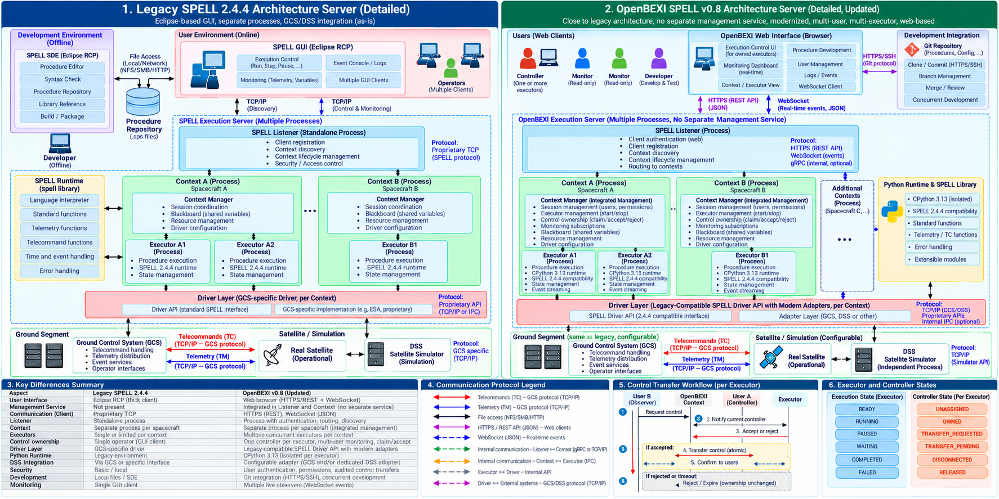
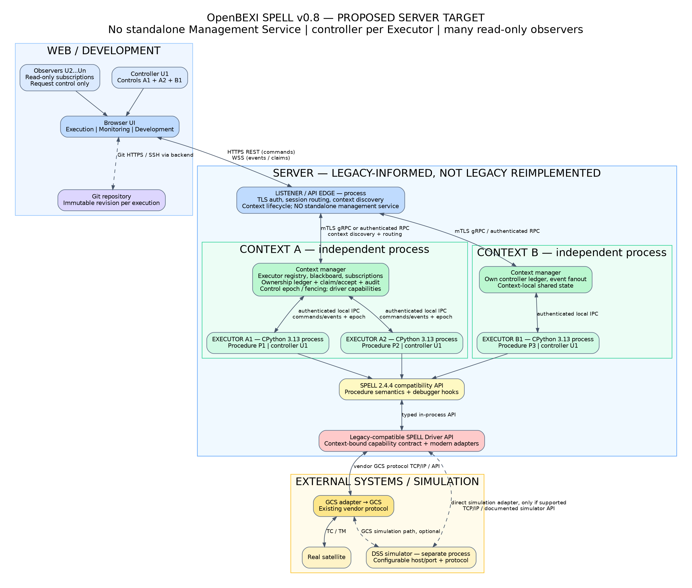

# OpenBEXI SPELL plugin

Optional native SPELL integration for OpenBEXI IDE, IntelliJ IDEA and PyCharm, with a DSS bridge and shared execution services. The root Python package is the separate bounded simulator SDK.

## Current status

**November 22 release decision — HOLD.** IDE **1.2.2** and SPELL **0.8.0** are the candidate pairing (IDE `3ec9d4d9` and SPELL `99686362`). The simulator SDK uses **0.1.0**. The installed Windows client and authenticated Chromium workspace can launch a native procedure and display its result. Published IDE 1.2.1 passed ordinary Python Run/Debug and stopped at reservation in the paired SPELL test. [Tested artifacts and limitations](docs/v0.8/evidence/qualification-20261122/README.md)

Both five-minute sanitizer workloads exceeded the approved 64 MiB growth limit. Controller handoff grew by **259.07 MiB** and the installed IDE by **308.17 MiB**, with zero swap. The original one-hour runs remain gated. Full native compatibility, supported deployments, JetBrains host acceptance and independent security review remain open. [Qualification status](docs/v0.8/CURRENT_STATUS.md) · [Roadmap](ROADMAP.md)

## Use and develop

[Installation and recovery](docs/V07_INSTALLATION.md) · [native host](docs/HOST_RUNTIME.md) · [JetBrains setup](docs/JETBRAINS_HOST.md) · [v0.8 implementation](docs/v0.8/README.md)

The existing local desktop at `http://127.0.0.1:6088` uses the v0.7 native baseline. Follow the setup guide for the matching release; desktop health does not establish v0.8 qualification. [Development dependencies and retained tooling](docs/DEPENDENCIES.md) describe fresh-checkout verification.

## Architecture reference

[Supplied ZIP, provenance and scope](docs/v0.8/reference/README.md). Both images below are unchanged extracts of the user-supplied architecture release package. They describe design intent; [current status](docs/v0.8/CURRENT_STATUS.md) defines implemented and qualified scope.

**Historical comparison (non-normative)**

**Proposed v0.8 server architecture**

[Documentation index](docs/README.md) links to setup, detailed evidence and historical records.
