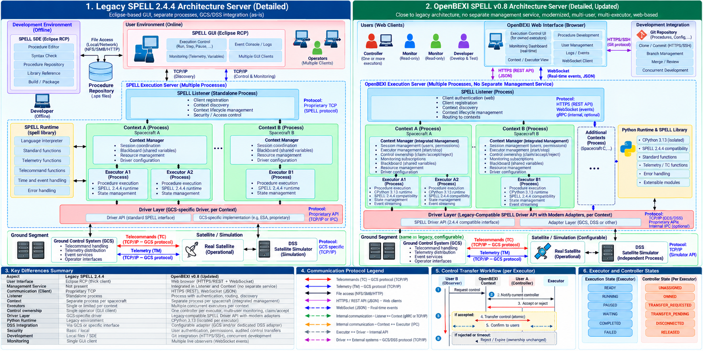
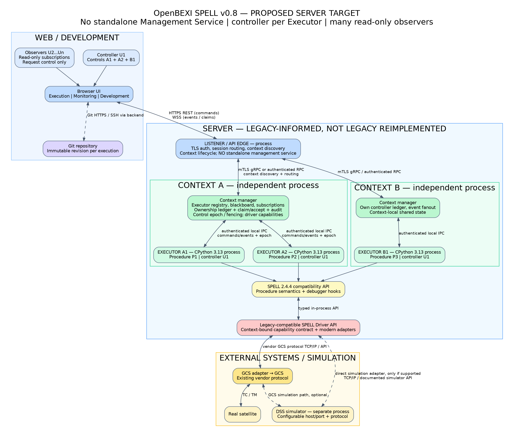

# OpenBEXI SPELL plugin

Optional native SPELL integration for OpenBEXI IDE, IntelliJ IDEA and PyCharm, with a DSS bridge and shared execution services. The root Python package is the separate bounded simulator SDK.

## Current status

**IDE v1.2.1 and SPELL v0.8-rc1 remain unqualified.** All eleven full-release groups are open. The reference Linux foundation passed **1,823 tests in 547.880 seconds**, with zero failures, errors or skips and the original 600-second limit. Matched concurrent requests and heartbeats pass under measured conditions; preserved storage-stall failures prevent an unconditional reliability claim.

The complete **303.491-second** Context/bridge diagnostic captured all eight processes and zero swap, but growth was **304.76 MiB** against **64 MiB** allowed. No conforming memory correction is established. Both original one-hour scenarios remain pending; cleanup and branch consolidation do not qualify a release.

[Current status and next work](docs/v0.8/CURRENT_STATUS.md) · [roadmap](ROADMAP.md) · [deadline and memory evidence](docs/v0.8/CONTEXT_DSS_DEADLINES_20261105.md) · [cleanup and recovery](docs/REPOSITORY_MAINTENANCE.md)

## Use and develop

[Installation and recovery](docs/V07_INSTALLATION.md) · [native host](docs/HOST_RUNTIME.md) · [JetBrains setup](docs/JETBRAINS_HOST.md) · [v0.8 implementation](docs/v0.8/README.md)

The existing local desktop at `http://127.0.0.1:6088` uses the v0.7 native baseline. Follow the setup guide for the matching release; desktop health does not establish v0.8 qualification. [Development dependencies and retained tooling](docs/DEPENDENCIES.md) describe fresh-checkout verification.

## Architecture reference

[Supplied ZIP, provenance and scope](docs/v0.8/reference/README.md). Both images below are unchanged extracts of the user-supplied architecture release package. They describe design intent; [current status](docs/v0.8/CURRENT_STATUS.md) defines implemented and qualified scope.

**Historical comparison (non-normative)**

**Proposed v0.8 server architecture**

[Documentation index](docs/README.md) links to setup, detailed evidence and historical records.
