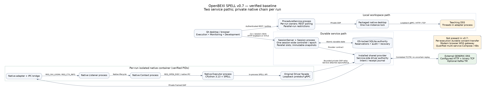
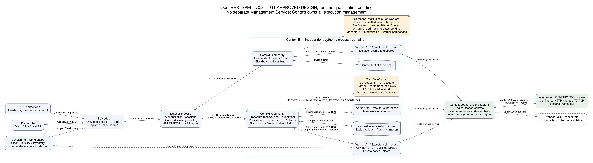

# v0.8 proposed architecture and migration

**TARGET-v0.8. G1 owner-authorized for staged implementation under
[G1 review resolutions](G1_REVIEW_RESOLUTION.md); runtime qualification pending.**

The Listener handles client authentication, sessions, configured Context
discovery, routing and connection health. Each Context is a separate process
with its own execution registry, reservations, blackboard, controller/claim
state, event journal and driver binding. Initial Compose worker containers are single-use per admitted execution family;
there is no automatic reuse (F4). A worker owns an isolated procedure
runtime and debugger. There is no separate Management Service or standalone
execution-manager process.

## Authority flow

The TLS edge authenticates a client certificate and routes only to the Listener
over an authenticated private link. The Listener maps the registered identity
to a stable user and Context-scoped permissions. Browser fields never select
their own role or principal. Forwarded identity headers from arbitrary clients
are stripped, and Listener trusts only its configured edge service identity.

Context validates the authenticated Listener and request delegation, then
checks scoped user permission and execution ownership itself. A successful
start durably reserves `(ContextID, ProcedureID)`, worker slot, immutable
source/revision and initial ownership before worker launch. Worker accepts
only its bound Context and execution generation. It has no authority database
mount or direct DSS route. All driver writes return through Context admission
with current execution epoch and procedure fence.

One user can own A, B and C simultaneously. U2's request for B creates a claim
without changing B's owner. Only B's current controller can accept with its
current epoch/capability. The Context atomically advances B's epoch, issues U2
a fresh capability through U2's authenticated connection, and appends ownership
events. A and C are untouched. UI state follows authority snapshots/events,
not optimistic browser button state.

## Deployment choices

Compose has one Listener, two Context services, a bounded static pool of
worker services and an independent DSS service. Only the TLS edge publishes
a host port. Worker agents supervise one active native execution each; they
are runtime adapters, not orchestration authorities. Contexts route claims,
control, blackboard and driver operations. Initial qualification capacity is
10 distinct concurrent executions and at least 20 observers.

Kubernetes uses the same authority/protocol contracts with one Context
replica per identity and one Executor Job/Pod per execution. Use Kustomize
base plus dev/test/prod overlays. Each Context has its own single-writer
storage and constrained launch identity. Multi-replica Listener/Context, HA,
automatic uncertain-command replay and vendor mission operation are outside
the proposal.

The currently qualified native worker contains private native Listener/Context
helpers. Reuse that engine composition initially, behind a new multi-execution
Context authority; do not turn those helpers into independent public control
planes. The language corpus must be rerun against the resulting provider.

## Migration sequence after approval

1. Implement versioned service contracts, per-execution durable authority and
   deterministic concurrency/claim tests in a new plugin server package.
2. Add Listener/Context process entry points and worker-provider contracts;
   run independent lifecycle, identity and crash tests before UI integration.
3. Adapt accepted native worker/DAP/driver behavior to the private worker RPC;
   preserve source inventory, no-replay journals and per-write authority checks.
4. Add neutral client/UI capability contracts on a separate IDE feature branch:
   multiple panels, owner/viewers, modes, claims and replay/resync.
5. Qualify Compose, then actual Kubernetes, browser, compatibility and security
   gates. Preserve all failed attempts and exact source/artifact identities.
6. Prepare release artifacts/PR with green CI and request release approval.
   Merge/tag/publish only after that separate approval. Use separate v0.8
   volumes and a validated offline import; retain v0.7 rollback unchanged.

See [acceptance plan](ACCEPTANCE_PLAN.md) and
[review findings](ARCHITECTURE_REVIEW.md) for mandatory stop conditions.
