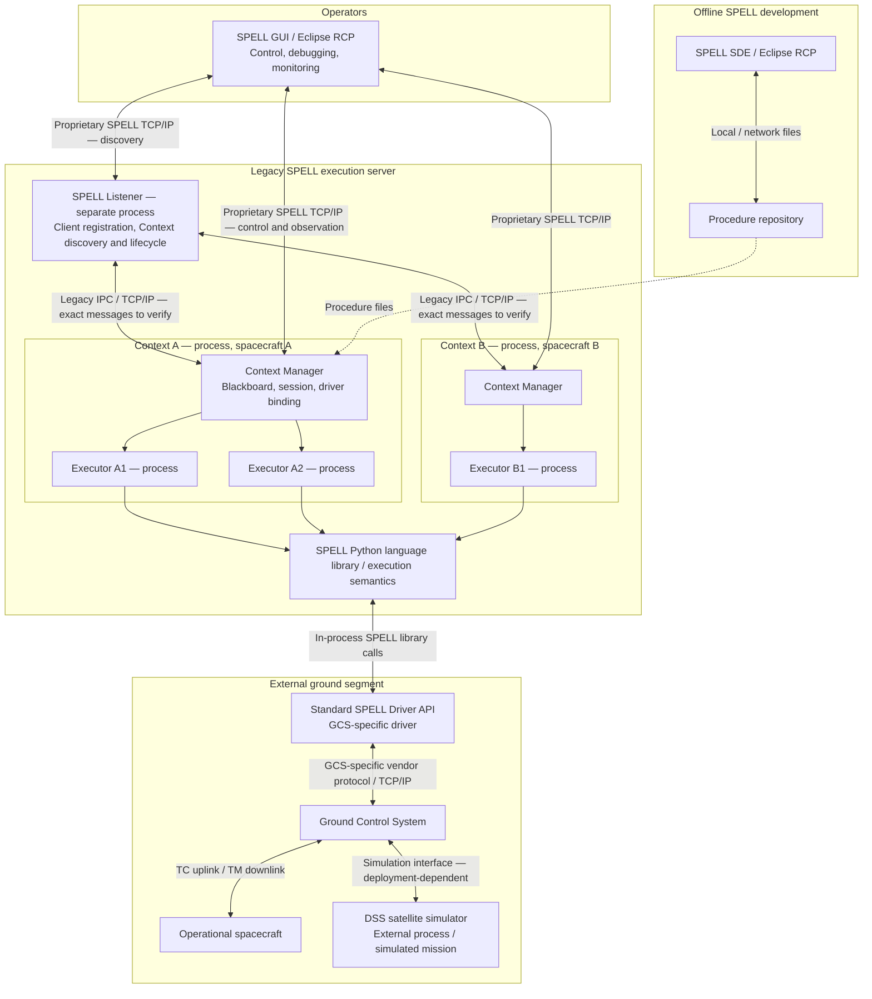
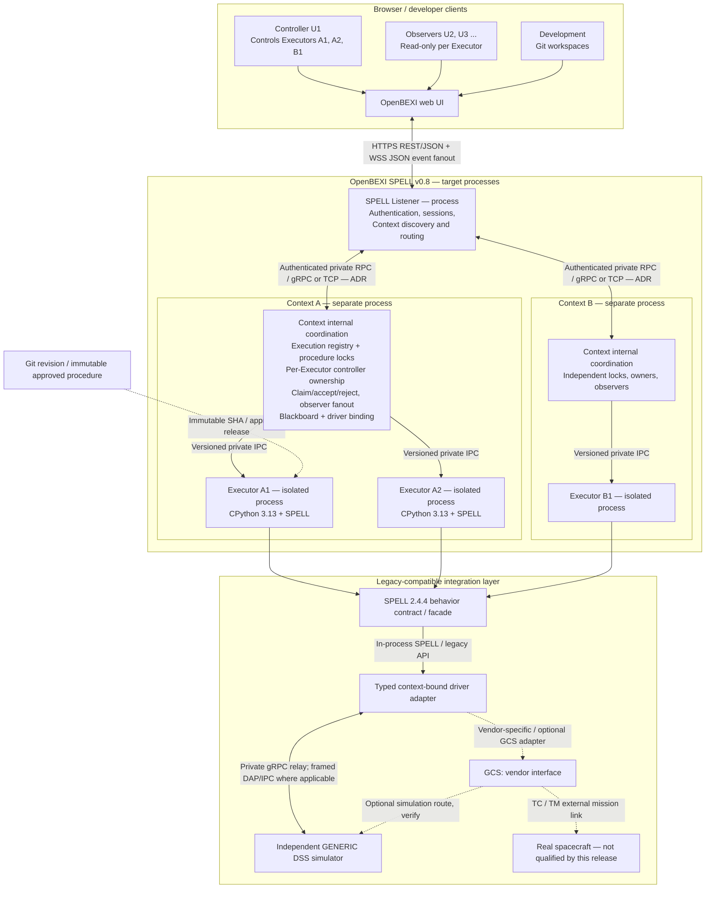
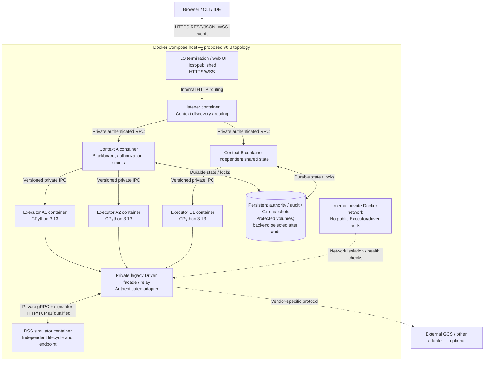
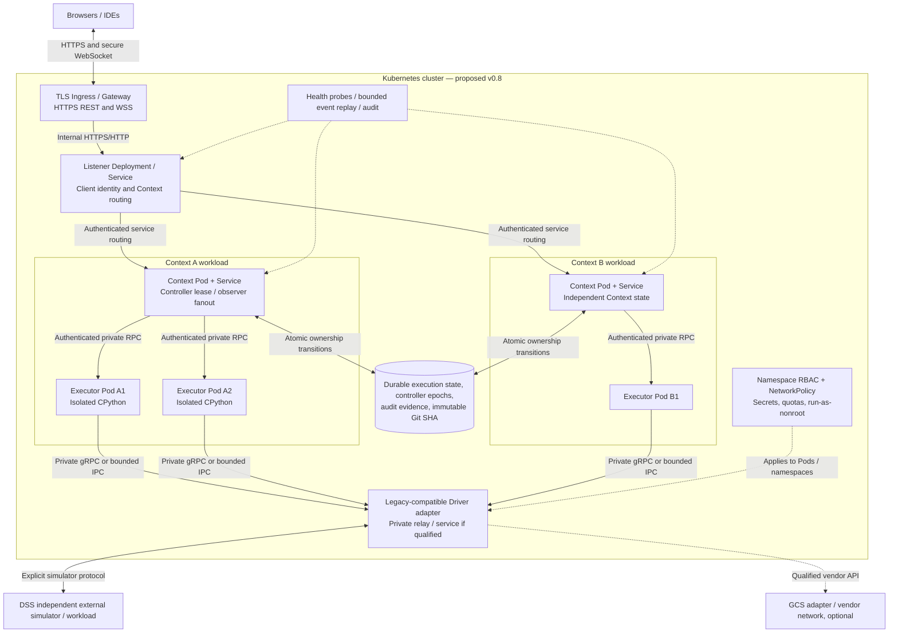
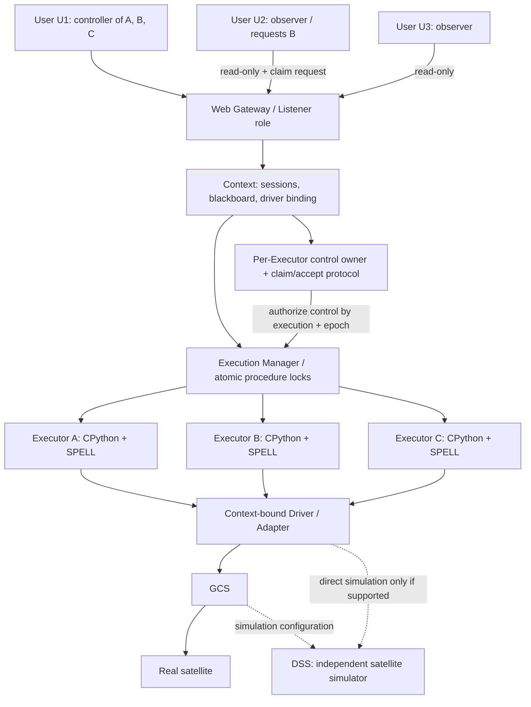

# OpenBEXI SPELL v0.8 — Revised Architecture, Containers, Qualification and GitHub Publication

**Target design, not verified implementation.** Published baseline v0.7. Legacy SPELL 2.4.4 is a behavioral reference, not code to restore. **No separate Management Service.** Listener handles registration/discovery/routing; each Context handles Executor lifecycle, blackboard, driver binding, controller claims and observers. Executors are isolated CPython 3.13 processes.

## Architecture figures

### Legacy SPELL 2.4.4 — reference architecture and protocols

*Legacy protocol names are architectural categories; verify original versions, message framing and routing against the applicable manuals and source.*

### OpenBEXI SPELL v0.8 — target server architecture and protocols

*Architecture target only; v0.7 already qualifies a native Listener–Context–Executor chain and DSS/driver transport. Do not treat the proposed browser entry and consent-transfer protocol as implemented.*

**Control invariant:** An Executor has at most one controller, but one user may control many Executors. Observers cannot mutate execution state; control claims require explicit acceptance from the active controller. Administration and management functions remain inside Listener and Context; there is **no separate Management Service**.

### Docker Compose — detailed target deployment

*Compose is a deployment proposal, not a claim of a currently qualified, multi-container v0.8 release. Enforce non-root users, read-only filesystems, memory/CPU/PID limits, health checks, loopback/public port policy, explicit secrets and fail-closed ownership recovery.*

### Kubernetes — detailed target deployment

*Executor Pod lifecycle, fencing, lease persistence, reconnect, affinity, privileged Docker access, Kubernetes network policy and resource admission are design gates—not proven features. No assumption of HA or automatic replay.*

## Reasoning scale

- **R5 — Extra High:** architecture, protocol safety, control claims, concurrency, recovery, compatibility, security, deployment isolation and publication.
- **R4 — High:** feature implementation, test harnesses, Compose/K8s manifests, UI and CI.
- **R3 — Medium:** formatting, routine documentation and examples.

Reasoning does not substitute for source inspection or executed tests. Label evidence as `VERIFIED-v0.7`, `DOCUMENTED-LEGACY`, `TARGET-v0.8` or `UNKNOWN`.

# OpenBEXI SPELL Plugin v0.8 — Legacy-Informed, Modern Multi-Executor Server

## Mission and non-goals
Starting from the **published v0.7** baseline, design and implement **v0.8**. Study the legacy SPELL 2.4.4 Listener → Context → Executor architecture as a **behavioral reference**, not as code to restore, reproduce, or mechanically port. Optimize the modern server architecture when justified by isolation, reliability, scalability, maintainability and security. Retain OpenBEXI's lightweight web UI, Git-backed development, CPython 3.13 target, SPELL compatibility and independent satellite simulator (DSS). Do not assume the v0.7 code already contains features that have not been verified.

**Primary non-negotiable objective:** Many distinct SPELL procedure Executors run concurrently. A single authorized operator can control several Executors at the same time. Many other authenticated users can observe each Executor concurrently, but observers cannot issue control commands. An observer may **request control** of an Executor; control transfers **only after the current controller explicitly accepts** that request. A request never automatically grants control.

## 1. Audit before implementation
1. Record v0.7 Git tag/commit and inspect all branches, changes, process boundaries, APIs, tests and configurations; preserve existing work.
2. Review legacy manuals and available source to identify Listener, Context, Executor, driver and blackboard semantics. Record evidence and uncertainties; legacy parity is not mandatory when a better design meets functional contracts.
3. Trace procedure start, status events, operator commands, monitoring subscriptions, driver calls, GCS and DSS communication, failures and reconnections in the actual v0.7 code.
4. Produce `docs/v0.8/BASELINE_V07.md`, `LEGACY_REFERENCE.md`, `ARCHITECTURE_DECISIONS.md`, `GAP_ANALYSIS.md`, and an as-is diagram. Present the proposed architecture and acceptance tests before invasive modifications.

## 2. Server structure: legacy-informed, not legacy-restored
- **Gateway / Listener role:** authenticated entry point, client/session registration, Context discovery, routing, health and connection lifecycle. It may be implemented as a dedicated service or a clearly isolated gateway component if this is demonstrably simpler and equally reliable. It does not run procedures.
- **Context:** first-class isolated logical environment with configuration, procedure registry, shared state/blackboard, driver binding, executor registry, event fanout and authorization. Use separate processes where isolation benefits justify them; document the chosen boundary rather than blindly copying legacy topology.
- **Execution Manager:** atomically starts and supervises Executor workers, maintains execution IDs and states, and enforces one active instance **per (ContextID, ProcedureID)** by default; distinct procedures run in parallel. Decide whether cross-Context duplicate procedure identities require a stronger policy and document it.
- **Executor:** separate OS process or equivalent rigorously tested isolation per active execution, with CPython 3.13, SPELL 2.4.4 compatibility layer, debugger, structured logs and explicit lifecycle.
- **Driver / adapter:** context-bound integration boundary, not a UI concern. Support configurable Driver → GCS → satellite, Driver → GCS → DSS, or Driver → DSS only where verified and supported. DSS is an independent external simulator with its own process and TCP/IP endpoint.
- **UI:** separate Execution, Monitoring and Development modes. Core UI remains domain-neutral. Development uses Git and immutable execution revisions.

## 3. Parallel execution and controller ownership — MUST IMPLEMENT
### Execution multiplicity
- Multiple distinct procedures may run concurrently in the same Context and across Contexts.
- **One human user may simultaneously control Executor A, Executor B and Executor C**; there is NO global one-executor-per-user restriction.
- Each active Executor has **at most one controller at a time**. Different Executors may have different controllers or the same controller.
- Any number of authorized users may monitor any Executor simultaneously, subject only to capacity limits.
- An observer may subscribe to events, logs, variable snapshots, current line, state and prompts, but cannot mutate execution or submit prompt responses.
- The server, not the browser, enforces controller ownership on **every** mutating command (RUN, PAUSE, CONTINUE, STEP, ABORT, RESTART, SKIP, GOTO, breakpoint mutation, prompt response and any other execution-affecting action).

### Control claim / transfer protocol
Implement an explicit **request–accept–transfer** handshake for each Executor:
1. Observer selects **Request control**; backend validates identity, permission, target execution and existing ownership, and creates a unique pending claim request with request ID, requester, controller, execution ID, timestamps and expiration.
2. Current controller receives a real-time notification with **Accept** and **Reject** choices. Until acceptance, the requester remains read-only.
3. **Accept** must be issued by the authenticated **current controller of that specific Executor** (not by a monitoring user or stale controller session). Reject leaves ownership unchanged.
4. On acceptance, atomically compare-and-swap controller ownership using an increasing **control epoch / fencing token**. Old controller loses mutating privileges immediately; new controller receives a fresh control token. Broadcast an auditable ownership-change event to all viewers.
5. On rejection or timeout, ownership remains unchanged. Notify requester and viewers as appropriate.
6. Prevent concurrent claims, duplicate acceptances, delayed commands, races and stale WebSocket sessions from creating two controllers. Serialize/queue pending requests or use an explicit single-pending-request policy, documented and tested.
7. **Controller disconnect:** do not silently transfer control to a requester. Maintain a configurable reconnect grace period and visible `CONTROLLER_DISCONNECTED` state. After grace expiry, use a clearly documented authorized administrative recovery mechanism; never treat an ordinary observer claim as approval. Prefer a safe unowned/frozen control state pending recovery.
8. **Controller voluntarily releases control:** define a safe `UNOWNED` state and explicit acquisition policy; do not conflate this with taking control away from an active controller.
9. **Controller crash/server restart:** persist or reconstruct owner, epoch and pending requests safely; invalidate stale control tokens; fail closed for mutation until ownership is resolved.
10. **Admin emergency override:** optional, explicitly privileged, audited, and separate from ordinary user claims; disabled by default unless operational requirements justify it.
11. If one user controls multiple Executors, transferring control of Executor B MUST NOT change their ownership of Executor A or C.

### Suggested API and event contracts (adapt to existing conventions)
- `POST /executions/{id}/control-claims` — request transfer.
- `POST /executions/{id}/control-claims/{claimId}/accept` — current controller accepts.
- `POST /executions/{id}/control-claims/{claimId}/reject` — current controller rejects.
- `GET /executions/{id}/control` — controller, epoch, pending claim status, redacted as needed.
- `POST /executions/{id}/commands` — mutating command requiring valid controller identity and current epoch.
- WebSocket events: `CONTROL_CLAIM_REQUESTED`, `CONTROL_CLAIM_ACCEPTED`, `CONTROL_CLAIM_REJECTED`, `CONTROL_CLAIM_EXPIRED`, `CONTROL_OWNER_CHANGED`, `CONTROLLER_DISCONNECTED`, `EXECUTION_STATE_CHANGED`.
- All endpoints require authentication, scoped authorization, idempotency and structured audit records. Use backend-generated timestamps and IDs.

## 4. Runtime, simulation and isolation
- CPython 3.13 is the execution engine; SPELL-specific functions and legacy semantics are a separate compatibility layer. Test behavior rather than assume Python version compatibility.
- Executor failure must not crash unrelated Executors. Listener/gateway failure must not implicitly kill all workers. Define Context failure behavior, reconnect, cleanup and resource limits.
- Maintain context-local shared state with concurrency safety and no cross-context leakage. Document whether procedures within one Context intentionally share blackboard values.
- DSS is an independent process with configurable host/port, independent lifecycle, health, logs and fault handling; `DSS_PORT != EXECUTOR_PORT` when sharing host. Do not confuse DSS with a Context or monitoring service.
- Protect execution control from replay, stale authorization, prompt hijacking and races; log all claim and transfer decisions.

## 5. UI behavior
- Executor dashboard lists many simultaneously running procedures and shows their Context, status, controller and viewer count.
- One controller can open multiple Executor control panels simultaneously.
- Observers see identical execution progress with clearly disabled control widgets and an enabled **Request control** action.
- Current controller sees non-blocking claim notification: requester identity, execution, elapsed time, **Accept** / **Reject**.
- Upon accepted transfer, both UIs update immediately; former controller becomes observer without disconnecting, new controller gains controls, all others remain observers.
- Make ownership and pending claims unambiguous; preserve responsive, simple, Apple-inspired visual design.

## 6. Required automated acceptance scenarios
1. User U1 starts A, B, C concurrently; all three run, and U1 controls all three.
2. U2 and U3 monitor A/B/C simultaneously; neither can pause, abort, step or answer prompts.
3. U2 requests control of B; U1 does not respond: U2 remains observer and U1 remains controller.
4. U1 rejects U2: B remains under U1 control.
5. U2 requests B again; U1 accepts: U2 controls B, U1 becomes B observer, **U1 retains control of A and C**.
6. U1's delayed PAUSE(B) with an old epoch is rejected after transfer; U2's PAUSE(B) succeeds.
7. Two users request B concurrently; only one transfer may complete, with no double controller.
8. Controller disconnect/reconnect, claim expiration, restart, worker failure, duplicate requests, unauthorized API calls and network partition all fail safely.
9. Duplicate start of the same (ContextID, ProcedureID) is rejected; different procedures start concurrently.
10. A DSS outage affects only dependent procedures according to documented policy; unrelated Executors remain alive.
11. Git editing never mutates an executing immutable procedure revision.
12. Test browser end-to-end flows with multiple authenticated sessions, not just mocked unit tests.

## 7. Deliverables and release gates
- Source changes on a dedicated v0.8 branch, no modification of published v0.7.
- `docs/v0.8/ARCHITECTURE.md`, `CONTROL_OWNERSHIP_PROTOCOL.md`, `EXECUTION_CONCURRENCY.md`, `DSS_INTEGRATION.md`, `SECURITY_AND_RECOVERY.md`, `TEST_REPORT.md`, `CHANGELOG.md`.
- Source-verified **as-is v0.7** and **target/as-built v0.8** architecture diagrams, including **high-resolution PNG** exports with legible component labels, process boundaries, control ownership, read-only subscriptions, and driver/GCS/DSS flows.
- All mandatory concurrency, control handoff, security and recovery tests passing before tagging `v0.8`.
- No claim of completed implementation without code evidence and passing tests.

## 8. Target architecture (conceptual, to be refined after audit)

**Implementation principle:** Keep the strengths of legacy SPELL's Listener/Context/Executor separation while choosing the cleanest modern service boundaries. The new feature defining v0.8 is **concurrent execution with per-Executor exclusive, consent-based control transfer and unlimited read-only monitoring (subject to configured capacity)**.

---
# 9. Binding architecture clarification (supersedes ambiguous earlier wording)

**There is NO separate Management Service and NO standalone Execution Manager process.** The term "Execution Manager" above means **functions inside each Context**: execution registry, locks, worker supervision, controller ownership, consent workflow and monitoring fanout. The Listener owns client registration, authorization entry, discovery and Context lifecycle. Each Executor owns procedure runtime/debugging only. Do not create a new independent service for these functions without explicit user approval.

**The Driver architecture is approved as:** `SPELL procedure → SPELL 2.4.4 API → legacy-compatible Driver facade → typed adapter interface → GCS adapter (or optional verified DSS adapter) → external system`. A Python function call is not a network protocol. The GCS adapter uses the real vendor transport; the GCS-to-DSS route must be verified. DSS means the **satellite simulator**, an independent process, not management or display software.

## 9.1 Required two diagrams

### Legacy SPELL 2.4.4 reference — verify exact internal protocols

See [Legacy SPELL 2.4.4 — reference architecture](#legacy-spell-244--reference-architecture-and-protocols), above.

### OpenBEXI SPELL v0.8 approved target — protocol labels and no management service

See [OpenBEXI SPELL v0.8 — target server architecture](#openbexi-spell-v08--target-server-architecture-and-protocols), above.

The diagrams are part of the architecture contract, **not proof that v0.7 currently implements any shown v0.8 component**. Copy both PNGs into `docs/v0.8/diagrams/`, retain editable Graphviz DOT sources, and update any protocol labeled "select", "verify", or "optional" only after collecting code/configuration evidence. Regenerate diagrams from source, not by editing pixels.

# 10. Protocol register and selection criteria — Extra High reasoning

| Communication path | Legacy reference | v0.8 proposed contract | Proof needed |
|---|---|---|---|
| GUI/browser → Listener | Legacy proprietary SPELL messages over TCP/IP | HTTPS REST/JSON + WSS for status/events | Inspect existing v0.7 routes and auth |
| Listener → Context | Legacy lifecycle/registration; transport details to verify | Authenticated versioned internal RPC; choose Unix socket, TCP or gRPC | Deployment and failure tests |
| GUI/browser → Context | Legacy proprietary TCP/IP control/monitor | Listener-routed, authenticated Context operations; no exposed internal browser socket | Trace authorization end-to-end |
| Context → Executor | Legacy interprocess protocol to verify | Versioned IPC, no public unauthenticated endpoint | Process trace and command correlation |
| Executor → SPELL API | Legacy Python/SPELL API | In-process CPython 3.13 compatibility calls | Behavior tests |
| SPELL API → Driver | Legacy standard Driver API | Compatible facade and typed adapters | 2.4.4 compatibility matrix |
| Driver → GCS | GCS-specific proprietary/API | Vendor-specific, configurable TCP/IP or SDK | Actual GCS documentation |
| GCS → DSS | Simulation-specific | Only when verified in target deployment | End-to-end simulator trace |
| Optional Driver → DSS | Not universally present | Only with verified simulator API | Explicit ADR |
| Development → Git | Legacy repository/files | Git HTTPS or SSH | Branch, conflict and release tests |

For each network link document: client/server direction, authentication, authorization, transport, port configuration, serialization, schema version, timeout, retry/idempotency, health check, reconnection and failure modes. **Do not invent fixed ports, wire protocols or persistence technologies.**

# 11. Detailed execution phases with reasoning levels and completion gates

## Phase A — Source evidence and v0.7 baseline [EXTRA HIGH]

1. Record repository URL, default branch, published v0.7 tag SHA, branch heads, CI state and open PRs.
2. Protect unsynchronized IntelliJ/Codex work: remote Git cannot see local uncommitted edits. Never reset/force-push.
3. Inspect actual code: process launchers, Listener-like entry point, Context registry, worker runtime, Python version, driver, DSS, UI, Git integration, tests and ports.
4. Read legacy SPELL 2.4.4 Server, GUI, Driver Development and Language manuals and any accessible legacy source. Mark every assertion `LEGACY VERIFIED`, `V0.7 VERIFIED`, `V0.8 PROPOSED`, or `UNKNOWN`.
5. Trace a real execution UI → entry → Context → Executor → SPELL API → Driver → GCS/DSS and return path; capture code paths, message types and process IDs.
6. Produce `BASELINE_V07.md`, `LEGACY_REFERENCE.md`, `PROCESS_AND_PORT_MAP.md`, `PROTOCOL_REGISTER.md`, `GAP_ANALYSIS.md`, `RISKS.md` and a source-backed as-is v0.7 diagram.

**Gate A:** Every proposed change maps to a verified gap or explicit v0.8 requirement. Independent review challenges assumptions. **No implementation before this gate.**

## Phase B — Architectural decisions [EXTRA HIGH]

Decide and record ADRs for Listener lifecycle, Context process isolation, Executor process-per-run, internal IPC choice, procedure lock scope, driver connection ownership, controller disconnect behavior, event delivery/replay, GCS/DSS topology and state persistence. Optimize for simplicity without changing required boundaries. No separate Management Service, message broker or database process unless independently justified and approved.

**Gate B:** Reviewed ADRs, threat model, sequence diagrams, updated process/protocol diagram and migration plan approved.

## Phase C — Listener implementation [HIGH; EXTRA HIGH review]

Implement client authentication, registration, Context discovery, Context lifecycle/routing and independent health. Keep the Listener out of procedure execution. Test unauthorized discovery, concurrent clients, Context restart, stale registry, Listener restart while Executors continue, network interruption and reconnect.

**Gate C:** Listener can restart without killing healthy Context/Executor processes; test logs attached.

## Phase D — Context implementation [EXTRA HIGH]

Implement Context as an isolated environment with ContextID, procedure catalog, blackboard/shared variables, per-Context Driver configuration, Executor registry, ownership registry and monitoring fanout. Context handles **all execution and control management functions internally**. Ensure blackboard and secrets do not leak between Contexts. Test simultaneous Contexts, startup/shutdown, orphan handling, configuration isolation and event ordering.

**Gate D:** Independent Context behavior demonstrated; no standalone management process exists.

## Phase E — Concurrent Executors [EXTRA HIGH]

Spawn separate CPython 3.13 Executor OS processes for distinct active procedures. Bind immutable Git SHA, ContextID, ProcedureID and ExecutionID. Define states and legal transitions. Implement run/pause/continue/step/abort/debugger subject to SPELL semantics. Atomically reject duplicate active execution of the same procedure in the approved scope; permit different procedures concurrently and one user to control many.

**Tests:** 100 simultaneous duplicate starts, A/B/C parallel starts, distinct PIDs, cross-procedure state isolation, driver-blocked pause, abort, stale locks, crash and restart.

**Gate E:** No duplicate active procedure; at least three different procedures run concurrently; process and test evidence retained.

## Phase F — Ownership, monitoring and consent [EXTRA HIGH]

Maintain exactly one effective controller per Executor, arbitrarily many authorized observers subject to capacity. Observers cannot run/pause/abort/step/modify breakpoints or answer privileged prompts. Observer B can request control of Executor X; Context notifies controller A. Only A can accept or reject. On acceptance, perform **atomic** transfer using execution ID and owner epoch/fencing token: revoke A, grant B, notify subscribers, make A an observer. On rejection/expiry, A remains controller. Multiple claims queue or reject according to documented policy. On controller disconnect, allow a bounded reconnect grace period; never silently promote an observer. Exceptional admin recovery requires explicit privilege, reason and audit.

**Tests:** claim/accept/reject/timeout/cancel, two simultaneous claims, stale controller commands, race between transfer and execution command, reconnect, unauthorized observer requests, one user controlling A/B/C, transfer only B while A/C remain controlled by original user, full audit order.

**Gate F:** No scenario permits two effective controllers or unconsented takeover.

## Phase G — SPELL runtime and Driver compatibility [EXTRA HIGH]

Use CPython 3.13 for language execution and introspection, with a separate SPELL 2.4.4 semantic layer. Preserve legacy Driver API behavior for telemetry reads/subscriptions, telecommands, acknowledgments, verification, waits, events, time, prompts, error handling, cancellation and cleanup. Add typed adapters below the compatibility facade. Driver configuration must be Context-bound, not a global singleton. Decide transport ownership and thread safety explicitly. Use deterministic fake adapters for tests.

**Gate G:** A source-referenced `SPELL_COMPATIBILITY_MATRIX.md` lists required features, tests and any approved deviations; no unexplained semantic regression.

## Phase H — GCS and DSS simulator [EXTRA HIGH]

DSS has its own OS process, host, port, health, lifecycle and logs. Distinguish operational `Driver → GCS → real satellite`, simulation `Driver → GCS → DSS`, and optional direct `Driver → DSS` only when the deployed simulator supports it. Implement configured endpoints, timeout and reconnect, TC/TM correlation, degraded state, simulation reset, network loss and GCS/DSS failure behavior. Never silently assume that the Executor uses 8080; verify and keep DSS on a distinct endpoint if applicable.

**Gate H:** Verified simulator round trip and fault-injection traces; stopping DSS does not terminate Listener or unrelated Executors.

## Phase I — Web, Git and multiuser development [HIGH; EXTRA HIGH security review]

Maintain Execution, Monitoring and Development modes with server-side permissions. Show Context/Executor hierarchy, owner, observers, claim requests, accept/reject, status, immutable revision, event logs and execution controls. Stream snapshots/events over WSS with resync on reconnect. Allow parallel Git workspaces/branches, including editing the same procedure with conflict detection. Do not mutate code already running in an Executor. Keep UI light and domain-neutral.

**Gate I:** Browser E2E tests with three concurrent Executors, controller of multiple Executors, at least three observers, claim/accept flow and simultaneous developers.

## Phase J — Security, resilience, performance [EXTRA HIGH]

Threat-model arbitrary Python execution, debug expression evaluation, control-token replay, session hijack, secret handling, driver privileges, Git operations, filesystem access and GCS/DSS network access. Use least privilege, OS isolation, timeouts/resource limits, TLS where applicable, authN/authZ, audit, log redaction and safe secret storage. Test Listener/Context/Executor/DSS crashes independently, restart/reconnect, event gaps, stale locks, 100+ observers where environment permits, backpressure and denial of service.

**Gate J:** Security checklist, risk acceptance for any remaining findings and reproducible recovery evidence.

## Phase K — CI, docs and qualification [HIGH; EXTRA HIGH independent review]

CI must run: formatting, linting, type checking, unit tests, Python 3.13 runtime qualification, SPELL compatibility, protocol contracts, driver fake-adapter tests, GCS/DSS integration, Context isolation, duplicate execution races, ownership/claim security, reconnect/failure injection, Git workflows, API tests and Chromium browser E2E. Produce reproducible commands, test artifacts, logs, version manifest, diagrams and documentation. Test failures must not be reclassified as passes.

**Gate K:** Clean checkout builds and all mandatory tests pass; exceptions documented with owner, risk and explicit approval.

## Phase L — Release candidate and GitHub publication [EXTRA HIGH]

1. Create a dedicated feature branch from the **verified correct baseline**, not blindly from an old tag if later remote changes exist.
2. Implement small reviewable commits; preserve v0.7 and any existing work. Keep CI green and request review at architecture/security boundaries.
3. Prepare `docs/v0.8/ARCHITECTURE.md`, `PROTOCOL_REGISTER.md`, `CONTROL_OWNERSHIP_PROTOCOL.md`, `DRIVER_COMPATIBILITY.md`, `DSS_INTEGRATION.md`, `DEPLOYMENT.md`, `SECURITY_AND_RECOVERY.md`, `TEST_REPORT.md`, `CHANGELOG.md`, `RELEASE_NOTES.md`, `KNOWN_LIMITATIONS.md`, and the two PNGs plus DOT sources.
4. Perform independent final architecture/compatibility/security review; verify release artifact checksums, dependencies, licenses and no credentials.
5. Open a PR, attach CI/test results and release notes. **Request explicit user approval before merge, tag or publication.**
6. Once approved, merge via repository policy, create annotated `v0.8` tag if naming policy agrees, publish GitHub release with notes and artifacts, and verify published tag SHA matches tested commit.
7. Run a post-publication smoke test; record release URL, tag SHA, CI run, known limitations and rollback procedure.

**Gate L:** GitHub v0.8 release is published **only** after approval, tests and verification. If no write access, prepare a PR-ready patch/bundle and provide precise remaining steps; never claim publication occurred.

# 12. Required acceptance matrix

| Requirement | Mandatory evidence |
|---|---|
| Listener → Context → Executor separation | OS process tree + component test |
| No separate Management Service | Deployment manifest + process list |
| Three parallel distinct procedures | E2E test + unique PIDs |
| Duplicate same-procedure start rejected | Concurrent race test |
| One user controls multiple Executors | Multiuser browser/API test |
| Multiple observers per Executor | Subscription/load test |
| Observer cannot issue control commands | Negative authorization tests |
| Control request requires current owner consent | Accept/reject/expiry E2E tests |
| Transfer atomic and per Executor | Fencing-token race tests |
| Legacy Driver facade retained | Compatibility/contract tests |
| GCS and DSS routes configured correctly | Real or validated simulation trace |
| DSS independent process | Separate PID/port and crash test |
| Python 3.13 + SPELL 2.4.4 semantics | Runtime qualification + compatibility matrix |
| Git revision immutable during execution | Git concurrency test |
| Clean CI + release evidence | CI links, artifacts, test report |
| GitHub v0.8 publication | Approved tag/release URL and SHA |

# 13. Mandatory response format after each phase

Report: (1) phase and reasoning level actually used, (2) exact commits/files inspected or changed, (3) verified findings versus assumptions, (4) test commands and outcomes, (5) architecture/protocol implications, (6) unresolved risks, (7) gate PASS/FAIL, and (8) next step. Stop on a failed mandatory gate; do not skip ahead or manufacture evidence. If a task requires the user's GitHub permissions or approval, request it and leave the repository unchanged until authorized.

# NORMATIVE ADDENDUM — latest agreed clarifications

## 1. Control authority — R5
- One user may control multiple Executors simultaneously; each Executor has at most one controller; any number of authorized users may observe (capacity tested).
- An observer may request control but cannot issue commands or answer prompts. Context sends claim to current controller; only **explicit authenticated acceptance by that controller** transfers ownership. Rejection, expiration, disconnect and duplicate requests leave ownership unchanged.
- Use Context-owned atomic compare-and-swap of `(ExecutionID, controllerID, controlEpoch)`; increment monotonic epoch and invalidate old controller commands immediately. Every mutating request includes execution ID, authenticated identity, idempotency key and current epoch.
- Controller disconnect never terminates execution automatically. Retain ownership for configurable grace; after expiry fail closed and require approved recovery. Optional emergency administrator override must be disabled by default, permissioned, reasoned and audited.
- Transfer of Executor A2 must not change ownership of A1 or B1. Execution state and controller state are independent. Never retry uncertain telecommands automatically.
- Minimum events: `CONTROL_CLAIM_REQUESTED`, `CONTROL_CLAIM_ACCEPTED`, `CONTROL_CLAIM_REJECTED`, `CONTROL_CLAIM_EXPIRED`, `CONTROL_OWNER_CHANGED`, `CONTROLLER_DISCONNECTED`, `CONTROL_RELEASED`, `EXECUTION_STATE_CHANGED`.

## 2. Protocol matrix — R5
| Edge | Legacy reference | Proposed v0.8 | Proof required |
|---|---|---|---|
| GUI/browser ↔ Listener | SPELL-specific TCP/IP; framing to verify | HTTPS REST/JSON + WSS | OpenAPI, auth, WSS replay |
| Listener ↔ Context | legacy TCP/IPC details to verify | authenticated versioned RPC / mTLS gRPC | identity, timeouts, health |
| Context ↔ Executor | legacy process IPC to verify | local structured IPC in Compose; mTLS RPC across K8s Pods | epoch fencing, cancellation |
| Executor ↔ SPELL API | legacy Python + SPELL library | CPython 3.13 + SPELL 2.4.4 facade | semantic corpus |
| SPELL API ↔ Driver | legacy Driver contract | legacy-compatible facade + typed adapters | capabilities and behavior |
| Driver ↔ GCS | vendor-specific API/protocol | preserve configured vendor protocol | GCS emulator + site test |
| GCS ↔ DSS or Driver ↔ DSS | site-specific | independently configured simulator protocol | faults, reconnect, isolation |
| Development ↔ Git | repository/files | Git HTTPS/SSH + immutable SHA | provenance |

**Protocol precision:** TCP/IP is transport, not an application message schema. Record TLS, serialization, correlation IDs, retries, timeouts, ordering and version negotiation separately. Do not invent legacy port numbers or vendor wire formats.

## 3. Driver architecture — R5
Preserve SPELL 2.4.4 Driver behavior as the compatibility contract. Below it, use Context-bound modern adapters for GCS, DSS or other systems. Declare capabilities: telemetry read/subscribe, command submit/ack/verify, event subscription, concurrency safety, ordering, cancellation, reconnection, timeout and health. Permit concurrent telemetry reads where supported; serialize only operations requiring exclusivity. Shared Driver connections belong to Context, not a global singleton. Use bounded queues, per-resource locks and correlation IDs. Support Driver→GCS→DSS and direct Driver→DSS only when the actual simulator interface is verified. DSS has independent process, PID, host/port, health and logs.

## 4. Docker Compose deployment — R5 design, R4 implementation
See Figure 3. Recommended services: `reverse-proxy` (only public 443/TLS), `listener-api` (private REST/WSS), `context-a`, `context-b` (separate process boundaries), isolated `executor` workers, optional transactional `state-db` (PostgreSQL or equivalent), optional non-authoritative `event-relay`, Git snapshot cache, and independent DSS service or external simulator.

**Critical Compose constraint:** Compose does not automatically launch a fresh container per execution. Choose either (A) supervised separate OS subprocesses in a constrained worker service, or (B) a narrowly privileged job launcher. Do **not** mount an unrestricted Docker socket in the Listener or Context containers. Document cleanup, crash detection, PID/memory/CPU limits and per-execution isolation.

**Networks:** `edge` for proxy→Listener, `control` for Listener↔Contexts↔state, `driver-egress` for authorized worker/adapter→GCS/DSS. Only reverse proxy publishes a port. Service DNS, not fixed IPs. Example ports in figures are illustrative and require collision check. Compose networking alone is not a full egress firewall; use host/network controls.

**Hardening:** non-root UID, dropped capabilities, no-new-privileges, read-only filesystem where possible, seccomp/AppArmor, secrets injected outside Git, read-only procedure snapshot, image digest pinning, SBOM/vulnerability scanning, resource limits and rotated structured logs. CPython `-I` is not a security sandbox.

**Lifecycle:** health-gated startup (DB, Contexts, Listener, proxy), bounded reconnect; shutdown drains new starts, fences mutations, reconciles active workers and avoids blindly repeating external commands. `depends_on` is not a substitute for application readiness.

**Deliverables:** `deploy/compose/compose.yaml`, `.env.example`, `docs/v0.8/COMPOSE_RUNBOOK.md`, `scripts/qualify-compose.sh`, network matrix, backup/restore procedure. Validate with `docker compose config`, clean boot, 10 concurrent distinct procedures, 20 observers, ownership races, Listener restart, Context crash, DSS outage, DB recovery and credential-negative tests.

## 5. Kubernetes deployment — R5 design, R4 implementation
See Figure 4. Namespace `openbexi-spell`; Gateway/Ingress with TLS/WSS; Listener Deployment and ClusterIP Service; separate Context A/B Deployments or StatefulSets and Services; **one Executor Pod/Job per active procedure** (or demonstrably equivalent isolation); transactional control-state store; optional event relay; ConfigMaps/Secrets; NetworkPolicies; narrow ServiceAccounts/RBAC; quotas and resource limits; metrics/tracing/logging.

**Listener replicas:** one initially. Multiple replicas require shared Context registry, session routing and replay tests. **Context replicas:** one authoritative instance per ContextID; never run two active owners without leader election plus fencing. Kubernetes alone does not establish high availability.

**Worker launch:** Context or a narrowly privileged launcher creates Jobs via namespaced RBAC only. Label Pods with ContextID, ExecutionID, ProcedureID, immutable Git SHA and epoch. Use Kubernetes API idempotency and atomic `(ContextID, ProcedureID)` reservation before Pod creation. Node partition or unreachable worker is **not proof of termination**; fence before replacement and require operator reconciliation for uncertain external commands.

**Inter-Pod communication:** authenticated gRPC/HTTP RPC with service identity and NetworkPolicy. Unix sockets cannot span Pods on separate nodes. GCS/DSS connectivity through allowlisted egress and configured vendor protocols; DSS may run outside cluster or in a separate independent Pod/Service, never inside Executor.

**K8s security:** default-deny ingress/egress, explicit service paths, restricted Pod Security, non-root, read-only root filesystem, seccomp, dropped capabilities, no cluster-admin, secrets rotation, image provenance, PDB where useful, readiness/liveness/startup probes, namespace quota, TTL cleanup, backup/restore.

**Deliverables:** `deploy/k8s/base/` Namespace, Deployments, Services, ServiceAccounts, RBAC, NetworkPolicies, ConfigMaps, example Secrets, Executor Job template; `deploy/k8s/overlays/dev|test|prod/` using Kustomize or Helm (choose one); `docs/v0.8/K8S_RUNBOOK.md`; `scripts/qualify-k8s.sh`.

**Qualification:** kind/minikube smoke plus production-like cluster; 10 concurrent Executor Pods, 20 observers, simultaneous claims, kill Pod/Context/Listener, node drain, DB fail/recover, stale epoch rejection, network partition, WSS replay, DNS outage, DSS loss, RBAC denial, egress deny, backup/restore and upgrade rollback. Capture commands, logs, timestamps, screenshots and pass/fail.

## 6. Required release gates — R5
| Gate | Evidence | Pass criterion |
|---|---|---|
| G0 baseline | v0.7 tag/SHA, source inventory, CI status | reproducible or blocker documented |
| G1 architecture | ADRs for Listener, Context, Executor, protocols, Driver, storage, Compose/K8s | reviewed and approved |
| G2 concurrency | 10 distinct procedures + duplicate same `(ContextID,ProcedureID)` | all distinct run, duplicate rejected |
| G3 ownership | 20 observers, accept/reject/expire/disconnect, epoch fencing | no dual controllers, no observer mutation |
| G4 compatibility | SPELL 2.4.4 corpus, Driver capability tests | approved semantics preserved |
| G5 simulation | GCS/DSS path, reconnect, timeout, unknown command outcome | deterministic and auditable |
| G6 Compose | clean deployment, health, failure injection, secrets | all required tests pass |
| G7 Kubernetes | RBAC/NetworkPolicy/Jobs, restart and partition tests | all required tests pass |
| G8 security | auth negative tests, scans, audit, source integrity | no critical blockers |
| G9 publication | green CI, version metadata, docs, PR approval, release tag | explicit owner approval |

**Release blockers:** dual controller, stale epoch accepted, observer mutating, duplicate active procedure within Context, uncertain telecommand replay, driver incompatibility without approval, missing qualification evidence, leaked secret, failed CI or wrong repository.

## 7. GitHub publication workflow — R5
1. Confirm exact GitHub repository URL, write access, v0.7 tag SHA and branches. Do not guess repository spelling or assume connected GitHub.
2. Create `feature/v0.8-server-architecture` from approved base; preserve existing commits and any unpublished IntelliJ/Codex work. No force-push.
3. Commit docs and diagrams in `docs/v0.8/` first, then implementation as reviewable commits. Include source `.dot` for reproducible diagrams and checksums for PNG/PDF.
4. Open PR against designated development branch; require code review, CI, security checks, test reports, architectural ADRs and rollback plan. User must approve merge, tagging and publication.
5. Set version to `0.8.0` or `v0.8` according to repository convention, verify package metadata, generate release notes and SBOM, build artifacts from exact SHA, tag annotated `v0.8` only after all gates pass.
6. Publish GitHub Release with docs, diagrams, checksums, known limitations, compatibility matrix, Compose/K8s qualification results and install/rollback instructions. Verify downloaded artifacts and tag SHA after publication.
7. Never claim publication if credentials, approval, CI or repository access are absent. Produce PR-ready artifacts and a precise blocker report instead.

## 8. Completion evidence required from development agent
Provide: commit SHA; v0.7 baseline SHA; modified-file list; architecture ADR list; test commands/results; concurrency traces; controller transfer trace with epochs; driver compatibility report; Compose and K8s deployment manifests and evidence; security report; changelog; release URL and tag SHA (only if actually published). Explicitly mark anything not tested.